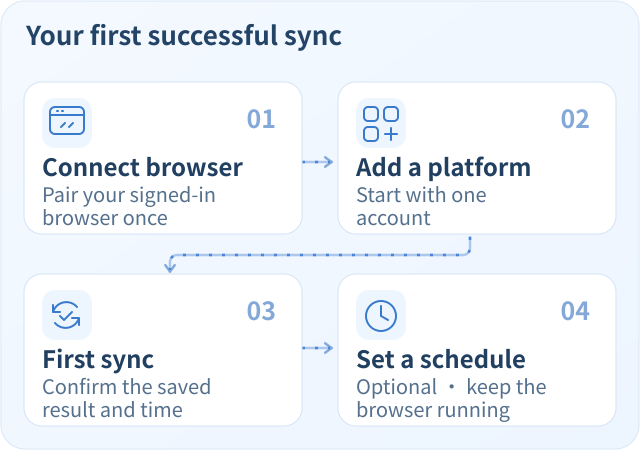

# Cross-platform Account Dashboard

[简体中文](README.md) · **English**

View account metrics, daily changes, and a cumulative post library from Xiaohongshu (RED), Douyin, Bilibili, and X in one local dashboard. Connect a browser where you are already signed in, then sync manually or build a history on a schedule.

[Get started](#get-started) · [Browser support](#browser-support) · [Usage guide — 中文](docs/USAGE.md) · [Contribute — 中文](CONTRIBUTING.md)


*Actual interface with synthetic accounts and demo data. Light and dark themes are available. The application interface is currently in Chinese; Chinese labels below help you find its controls.*

## What you can do

| Your question | What the dashboard provides |
| --- | --- |
| How are my accounts doing? | An overview of followers, following, total posts, and likes where the platform provides them |
| What has changed recently? | 7 / 30 / 90-day trends and daily net changes; unknown values and unobserved days stay empty |
| What have I published recently? | Backfill accessible history, then sync incrementally; saved posts accumulate and interrupted scans can resume |
| Can I keep a history without syncing manually each time? | Per-platform schedules: once daily or every 1 / 3 / 6 / 12 hours; disabled by default |

### Single-platform detail view

[](assets/account-detail.png)

*Actual detail page with a synthetic account and demo data. Gaps in the chart represent unobserved dates. Click the image to view it at full size.*

Run it on its own or inside [DSH Desktop](https://dshdesktop.com/). Each platform currently holds one bound account; unbind it before switching accounts. **The local service (or DSH Desktop) and the connected browser must stay running for syncing.** Sleep and downtime are not recorded or backfilled.

## Get started

Choose a launch option, then follow the four steps below. The home page’s “上手指南” (Getting started) also shows your current step; you can skip it and reopen it anytime.

| Launch option | Get started |
| --- | --- |
| **Standalone** | Install Node.js 22+, run the commands below, and open the local dashboard in your browser |
| **DSH Desktop** | Use the desktop application from the [official DSH Desktop site](https://dshdesktop.com/), then follow the [local package installation guide — 中文](docs/USAGE.md#安装到-dsh-desktop); local installation checked with **0.11.1** |

The two modes store data separately and do not share accounts or authorization automatically.

For standalone use:

```sh
git clone https://github.com/beianbai/cross-platform-account-dashboard.git
cd cross-platform-account-dashboard
npm install
npm start
```

Startup builds the interface and browser connectors automatically. Open the fixed local address printed in the terminal (default `http://127.0.0.1:43120/`) in any browser and enter the terminal's pairing code. Opening the address alone does not consume a code.

Each code expires after **five minutes** and can be redeemed **once**. To authorize another browser, generate a new code in “设置 → 访问授权” (Settings → Access authorization), or run `npm run auth:code` in another terminal from the project directory. No service restart is needed; pass the same `-- --root "data directory"` if you use a custom directory.

Browsers receive independent sessions and share the same local business data. Sessions can be revoked individually and survive restarts with the same data directory. They expire after 90 days of inactivity; clearing cookies or closing an incognito session may require pairing again. Upgrading from the old shared login requires pairing again, while preserving business data. Keep the service running; `Ctrl+C` stops it and scheduled syncing.

<details>
<summary>Start the standalone version with pnpm</summary>

The project pins pnpm 10.34.5. Run these commands in the project directory:

```sh
pnpm install --frozen-lockfile
pnpm start
```

</details>



### 1. Connect your browser

For Chrome / Edge:

1. Click “连接浏览器” (Connect browser), choose “浏览器扩展” (Browser extension), then download and extract the local connector.
2. Open `chrome://extensions` or `edge://extensions`, enable Developer mode, and load the extracted `chromium` folder as an unpacked extension.
3. Generate a connection code in the dashboard, paste it into the connector from your browser toolbar, and authorize it. Codes **expire after two minutes and work only once**.

Install the extension and confirm permissions yourself. Sign in to each platform in your own browser. Full instructions, including Firefox setup, are in the [connector guide — 中文](extension/README.md).

<a href="assets/browser-connector.png"></a>

*Actual extension interface with demo connection and task states; no real authorization details are shown. Click the image to view it at full size.*

### 2. Add one platform

Click “添加平台” (Add platform), select one platform, and start reading. If sign-in or a CAPTCHA is required, complete it on the platform page, then click “继续读取” (Continue reading) in the dashboard. The connector checks for tasks about every 30 seconds, so pickup may take a moment.

### 3. Confirm the first sync

**Success means an account card and sync time appear in the dashboard.** Open its details to see the metrics and posts collected. Trends accumulate from successful observations. “已提交” (Submitted) in the extension only confirms delivery; use the dashboard's final sync result to confirm that data was saved.

### 4. Optionally enable a schedule

In the platform settings, enable “自动同步” (Automatic sync) and choose a daily time or every 1 / 3 / 6 / 12 hours. Schedules are off by default; manual syncing remains available. Keep the local service (or DSH Desktop) and browser running. See [daily history and scheduling — 中文](docs/USAGE.md#每日记录与自动同步).

The Release asset `cross-platform-account-dashboard.tgz` is for **DSH Desktop**. It includes the workbench UI and browser connectors, but not the prebuilt standalone UI. For **standalone use**, download or clone the source and run `npm install` followed by `npm start` as above; startup builds the full standalone interface.

## Browser support

| Browser | Connection and limitations |
| --- | --- |
| Chrome 120+ / current Edge | Load and pair the local Chromium connector |
| Other Chromium browsers | Require MV3, scripting, alarms, and local extensions; not individually verified |
| Firefox 115+ | Temporarily load `firefox/manifest.json`; reload it after restarting Firefox |
| Ego Lite | An optional adapter if already installed; not required |
| Safari / mobile browsers / managed browsers that block local extensions | No collection adapter is available; existing cached data can still be viewed |

Only one extension connection is authorized at a time; pairing again replaces the previous credentials. After updating the dashboard, [update the browser connector too — 中文](extension/README.md#060-更新).

## Data and collection limits

- **Stored locally.** Accounts, history, and authorization stay in a local directory. The standalone service listens only on `127.0.0.1`. See [storage, backups, and port settings — 中文](docs/USAGE.md#数据目录与备份).
- **Incremental post library.** First backfill history accessible through the website, then sync incrementally by default. There is no 200-post lifetime cap. Each batch is acknowledged after saving; interrupted scans can resume, and unseen older posts are retained. Without explicit end evidence, coverage stays unconfirmed. Passwords, cookies, private APIs, and media-file downloads are not used. See [library and collection scope — 中文](docs/USAGE.md#各平台读取范围).
- **Metrics keep their meaning.** Rounded values are marked as estimates. Net changes require consecutive calendar days in the same time zone. X's cumulative account likes remain unknown. See [platform-specific counting rules — 中文](docs/USAGE.md#各平台读取范围).
- **Recoverable failures.** Sign-in, verification, or account-identity problems retain the last successful data and pause the affected platform. Hiding a platform does not stop its schedule. Unbinding stops its schedule and keeps a local archive; rebinding the same account can restore it.

## Development and contribution

```sh
pnpm test
pnpm build
pnpm check
pnpm pack
```

- [Contributing — 中文](CONTRIBUTING.md): environment, source layout, and contribution requirements.
- [Add a platform — 中文](docs/PLATFORM-DEVELOPMENT.md): “添加平台 → 自定义平台” (Add platform → Custom platform) generates a development prompt; it does not activate an unimplemented platform.
- [Security — 中文](SECURITY.md) · [Changelog — 中文](CHANGELOG.md) · [MIT license](LICENSE).

The source is public on [GitHub](https://github.com/beianbai/cross-platform-account-dashboard), with no npm or marketplace release. `private: true` in `package.json` disables npm publication. Its legacy repository identifier is retained for compatibility with existing DSH installations; see [installation identity — 中文](docs/USAGE.md#开发与发布身份).
