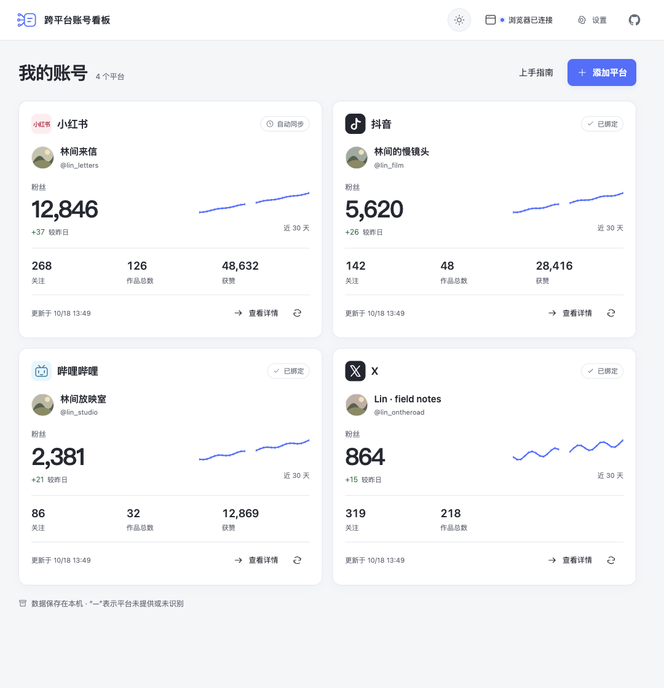
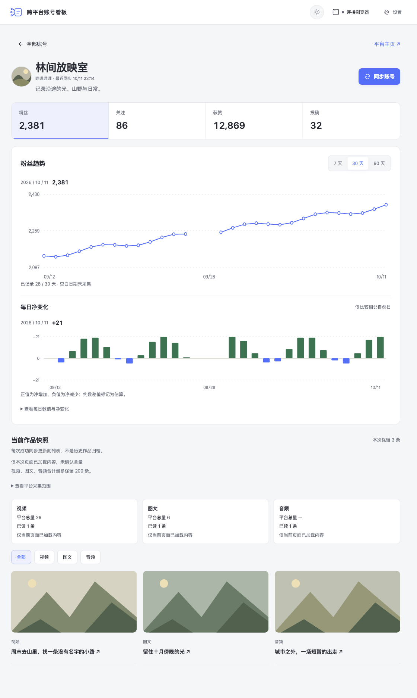
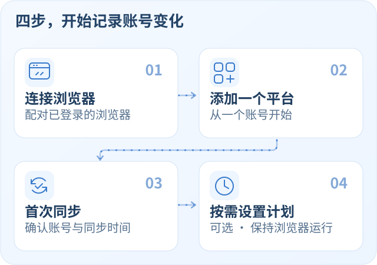
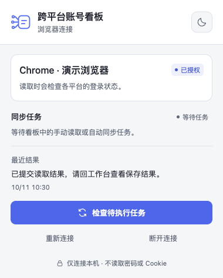

# 跨平台账号看板

**简体中文** · [English](README.en.md)

在一个本地看板查看小红书、抖音、哔哩哔哩和 X 的账号指标、每日变化与已加载作品。连接你已登录的浏览器，手动同步或按计划积累历史。

[开始使用](#开始使用) · [浏览器支持](#浏览器支持) · [使用指南](docs/USAGE.md) · [参与开发](CONTRIBUTING.md)



*实际界面，使用合成账号与演示数据。界面支持浅色／深色切换，当前界面语言为中文。*

## 能做什么

| 你想了解 | 看板提供 |
| --- | --- |
| 各平台账号的近况 | 在总览查看粉丝、关注、作品总数及平台可提供的获赞指标 |
| 账号最近的变化 | 7 / 30 / 90 天趋势与每日净变化；未知值和缺测日期留空 |
| 近期发布了什么 | 查看当前页面已加载的本人作品；不把列表长度当作作品总数 |
| 持续记录，不必每次手动操作 | 各平台独立设置每日定时或每 1 / 3 / 6 / 12 小时同步，默认关闭 |

### 单个平台详情

[](assets/account-detail.png)

*实际详情页，使用合成账号与演示数据；图表中的空白表示未采集的日期。点击图片可查看原图。*

既可独立运行，也可安装到 [DSH Desktop](https://dshdesktop.com/)。当前每个平台绑定一个账号，切换账号需先解除旧绑定。**同步时，本机服务（或 DSH Desktop）和连接的浏览器都需要保持运行。** 休眠或关闭期间不采集，也不补造历史。

## 开始使用

先选择一个运行入口，然后按下面四步完成第一次使用。首页「上手指南」也会提示当前步骤，可跳过并随时重新打开。

| 运行入口 | 如何开始 |
| --- | --- |
| **独立运行** | 准备 Node.js 22+，执行下方命令，在浏览器打开本地看板 |
| **DSH Desktop** | 使用 [DSH Desktop 官网](https://dshdesktop.com/)提供的桌面应用，按[本地包安装说明](docs/USAGE.md#安装到-dsh-desktop)安装并打开看板；本地安装核对版本 **0.11.1** |

两种方式分别保存数据，不自动共享账号或授权。

独立运行：

```sh
git clone https://github.com/beianbai/cross-platform-account-dashboard.git
cd cross-platform-account-dashboard
npm install
npm start
```

启动会自动构建界面与浏览器连接器。打开终端显示的**完整本机链接**，应看到「跨平台账号看板」和添加平台的入口。首次链接含本机授权，不要分享；打开后地址栏会自动移除授权片段。

默认地址为 `http://127.0.0.1:43120`，首次访问请使用终端链接。之后同一浏览器可直接访问该地址。按 `Ctrl+C` 停止服务，自动同步也随之暂停。

<details>
<summary>使用 pnpm 启动独立版</summary>

项目固定使用 pnpm 10.34.5，在项目目录运行：

```sh
pnpm install --frozen-lockfile
pnpm start
```

</details>



### 1. 连接浏览器

以 Chrome / Edge 为例：

1. 在看板点「连接浏览器」，选择「常用浏览器 · 扩展连接」，下载并解压本地连接器。
2. 打开 `chrome://extensions` 或 `edge://extensions`，启用开发者模式，加载解压后的 `chromium` 文件夹。
3. 回看板生成连接码，在浏览器工具栏的连接器中粘贴并授权。连接码 **2 分钟有效、仅能使用一次**。

扩展安装和权限确认由你完成；平台登录也在你自己的浏览器里完成。完整步骤与 Firefox 说明见[连接器指南](extension/README.md)。

<a href="assets/browser-connector.png"></a>

*插件实际界面，使用演示连接与任务状态；不包含真实授权信息。点击图片可查看原图。*

### 2. 添加一个平台

点「添加平台」，先选择一个平台并开始读取。需要登录或验证码时，在平台页面完成后回看板点「继续读取」。连接器约每 30 秒检查任务，接收可能稍有延迟。

### 3. 确认首次同步

**成功标志：看板出现该账号卡片及同步时间。** 进入详情可查看本次读到的指标和作品；历史趋势从成功观测开始积累。扩展显示「已提交」仅表示结果送达，最终以看板保存后的同步结果为准。

### 4. 按需开启自动同步

在平台设置中开启「自动同步」，选择每日指定时间或每 1 / 3 / 6 / 12 小时同步。计划默认关闭，也可以一直手动同步。运行计划时保持本机服务（或 DSH Desktop）及浏览器开启，更多说明见[每日记录与自动同步](docs/USAGE.md#每日记录与自动同步)。

## 浏览器支持

| 浏览器 | 连接方式与限制 |
| --- | --- |
| Chrome 120+ / 当前版 Edge | 加载本地 Chromium 连接器并配对 |
| 其他 Chromium 浏览器 | 需支持 MV3、scripting、alarms 和本地扩展；未逐一实机认证 |
| Firefox 115+ | 临时加载 `firefox/manifest.json`；浏览器重启后需重新加载 |
| Ego Lite | 已安装时可作为可选适配器，不是必需依赖 |
| Safari / 移动浏览器 / 禁止本地扩展的受管浏览器 | 暂无采集适配器，仍可查看已有缓存 |

一次只授权一个扩展连接，重新配对会替换旧授权。看板升级后需[更新浏览器连接器](extension/README.md#050-更新)。

## 数据与读取边界

- **数据留在本机。** 账号、记录和授权存储在本地目录；独立版仅监听 `127.0.0.1`。存储位置、备份与换端口见[使用指南](docs/USAGE.md#数据目录与备份)。
- **只读当前页面。** 不读取密码或 Cookie，不访问平台私有 API，不绕过验证码，也不发帖、点赞、评论或关注。**每次同步最多处理当前页面已加载作品的前 200 条**；成功后替换作品列表，不累计归档全部作品，也不自动遍历所有分页。200 条是当前实现上限，不是平台限制；不影响平台作品总数或每日账号指标。详见[作品保存范围](docs/USAGE.md#各平台读取范围)。
- **保留数据原本的含义。** 约数标注估算；只在相邻自然日且时区一致时计算净变化。X 的累计获赞保持未知，各平台作品统计范围见[数据口径](docs/USAGE.md#各平台读取范围)。
- **失败可以恢复。** 登录失效、验证或账号不符时保留最后成功数据，并暂停受影响平台。隐藏平台不会停止计划；解除绑定会停止计划并保留本地归档，重新绑定同一账号可恢复。

## 开发与贡献

```sh
pnpm test
pnpm build
pnpm check
pnpm pack
```

- [贡献指南](CONTRIBUTING.md)：开发环境、代码分工与提交要求。
- [扩展新平台](docs/PLATFORM-DEVELOPMENT.md)：「添加平台 → 自定义平台」只生成开发提示词，不会直接启用尚未实现的平台。
- [安全说明](SECURITY.md) · [更新记录](CHANGELOG.md) · [MIT 许可](LICENSE)。

源码公开于 [GitHub](https://github.com/beianbai/cross-platform-account-dashboard)，尚未发布 npm 或市场。`package.json` 中的 `private: true` 用于禁用 npm 发布；其中的旧仓库标识仍用于兼容已有 DSH 安装，详情见[使用指南](docs/USAGE.md#开发与发布身份)。
