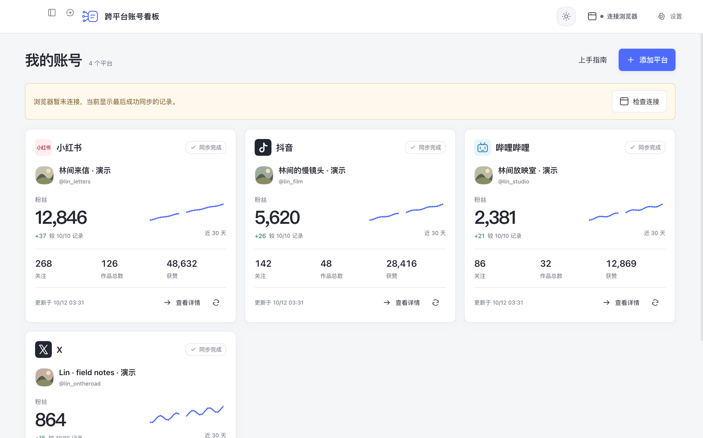
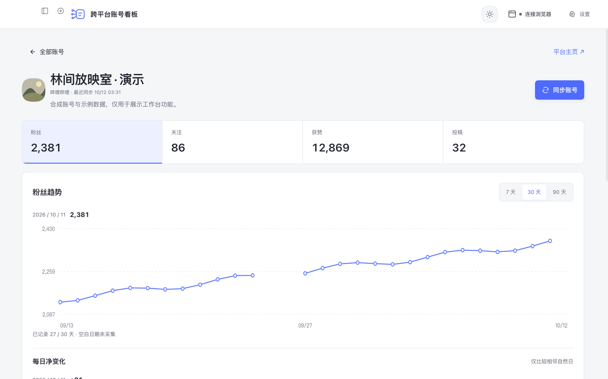

# DSH Desktop 0.6.2 本机验收记录

验收日期：2026-10-12。记录实际测试范围，不代表市场审核或全平台兼容结论。

## 安装来源

- 工作台：`dsh-workbench-personal-social-local@0.6.2`；源码：`177b655`。
- [Release v0.6.2](https://github.com/beianbai/cross-platform-account-dashboard/releases/tag/v0.6.2)。
- [实际下载的安装包](https://github.com/beianbai/cross-platform-account-dashboard/releases/download/v0.6.2/cross-platform-account-dashboard.tgz)。
- 大小：1,384,253 字节；SHA-256：`2ed8e08ae57978e73002065afbc65c79d96cb9411716bb2132736deaabc0a23b`。
- 从公开 Release 下载，校验与发布前一致；通过 Desktop 随附的 `dsh plugin --profile web add` 安装，禁用安装脚本。安装使用既有环境对应的 pnpm 10.34.5。
- 环境：DSH Desktop **0.11.1 / macOS arm64**。安装后退出并重启 Desktop；已安装列表实际显示 **v0.6.2**，侧栏切换器可进入工作台。

## 本轮检查

| 检查 | 结果 |
| --- | --- |
| 自动测试、构建、包检查 | 198 项测试通过；构建及工作台检查通过。新增测试真实生成并解包 tarball，执行客户端注册检查，并调用解包后服务的连接器下载路由。 |
| 官方安装契约 | 源码归档和实际 Release 包均通过官方 `inspectPackage`；入口、patch、仓库身份、版本、体积已核对。 |
| 分发范围 | 安装包没有 `lib/standalone.js`；保留 DSH 客户端、服务端、浏览器连接器与独立版构建源码。已安装客户端与本地构建逐字节一致。 |
| 原生打开与导航 | 重启后打开合成账号总览，进入哔哩哔哩详情和趋势，打开工作台主页的已安装列表，再经侧栏切换器返回业务界面。 |
| 界面 | 1383 × 863 CSS px 窗口没有整页横向溢出；检查浅色、深色、跟随系统三态切换。 |
| 时区与保存 | 实际点击时区下拉，出现北京、香港、台北、东京、首尔等选项；选择并保存显示“计划已保存”。 |
| 成功提示 | 修改演示环境采集通路后出现“连接偏好已保存”，4.6 秒后自动消失；表单内“计划已保存”仍保留。 |
| 原生连接器下载 | 从运行中的 Desktop 访问工作台下载端点，返回 HTTP 200、application/zip，71,064 字节。 |
| 独立运行 | 实际执行 `npm start`，自动构建后成功启动；页面、独立界面脚本和经过认证的连接器下载均返回 HTTP 200。使用单独测试数据目录。 |
| 原数据保护 | 截图及界面操作使用隔离的合成账号；结束后恢复原账号和浏览器授权目录，全部原文件的 SHA-256 与测试前一致。临时调试端口已关闭，Desktop 恢复正常启动。 |

## 本轮实拍

以下截图来自实际安装的 v0.6.2 在 DSH Desktop 内的界面，使用合成账号和自制头像。只等比缩小到宽 1600 px，没有改写界面或数据来伪装真实采集。

## 范围与未验证项

- 本轮改变分发清单、版本及文档，没有改变业务源码、数据格式或会话接口。此前完整安装、会话及卸载检查见 [0.6.1 记录](2026-10-12-desktop-0.6.1.md)；这些历史结果不冒充本轮重测结果。
- 0.6.2 本轮没有重新执行卸载、模型会话请求、四个平台真实账号采集或跨天定时任务；Windows、Linux 和其他 Desktop 版本未验证。
- 本机旧开发身份迁移造成的两个同名已安装条目仍存在；它们均显示 v0.6.2。未修改用户会话绑定或清理宿主记录。
- 包含独立版源代码及构建方式不等于提供预编译独立版安装包；独立运行应从源码按 README 安装依赖并启动。
- 代码、自制素材与演示截图沿用 MIT 授权。账号、作品、日记录和连接授权保存在本机；卸载数据保留策略未改变。本轮没有向平台发布内容或上传真实账号数据。
